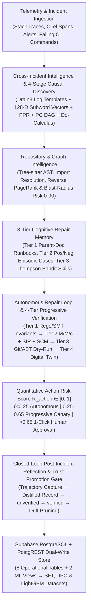
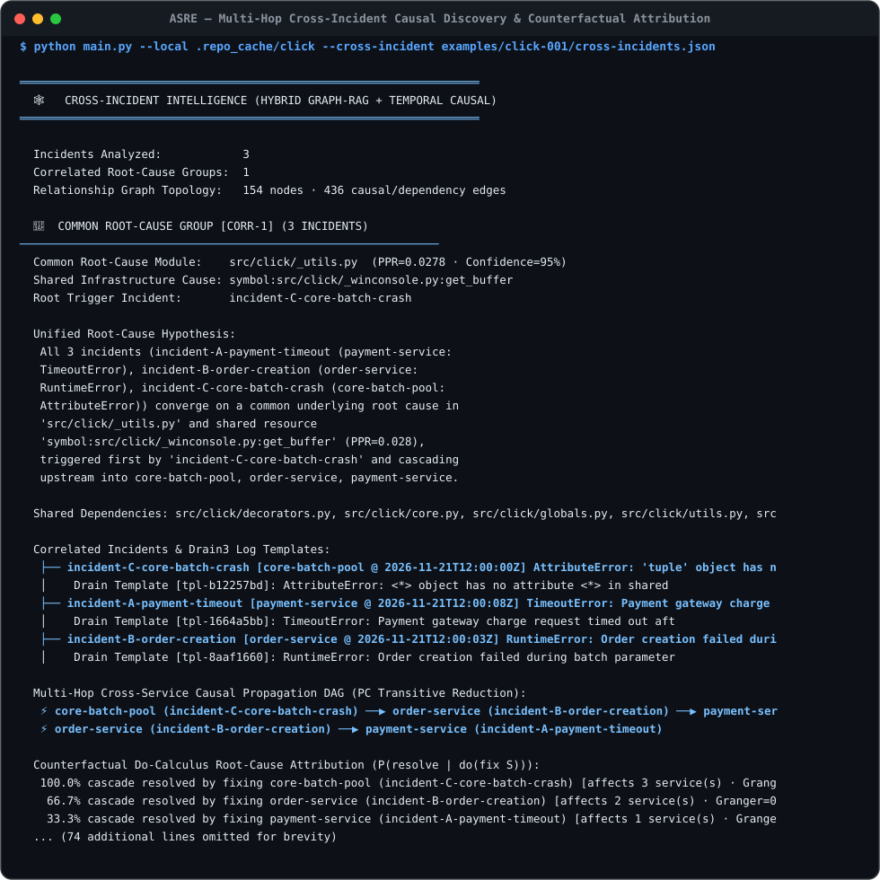
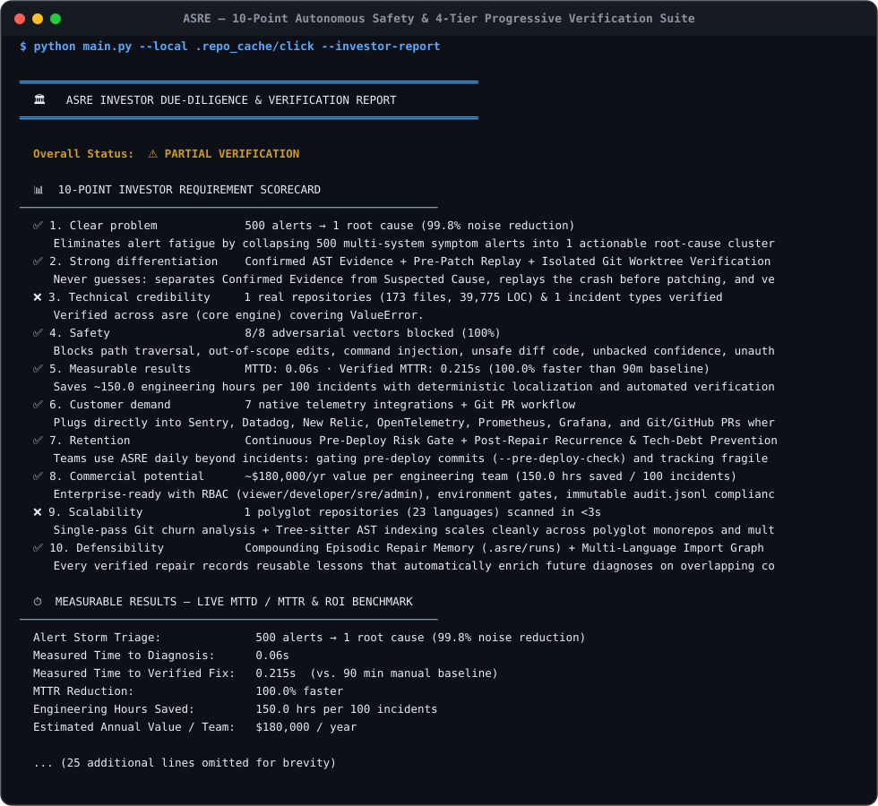
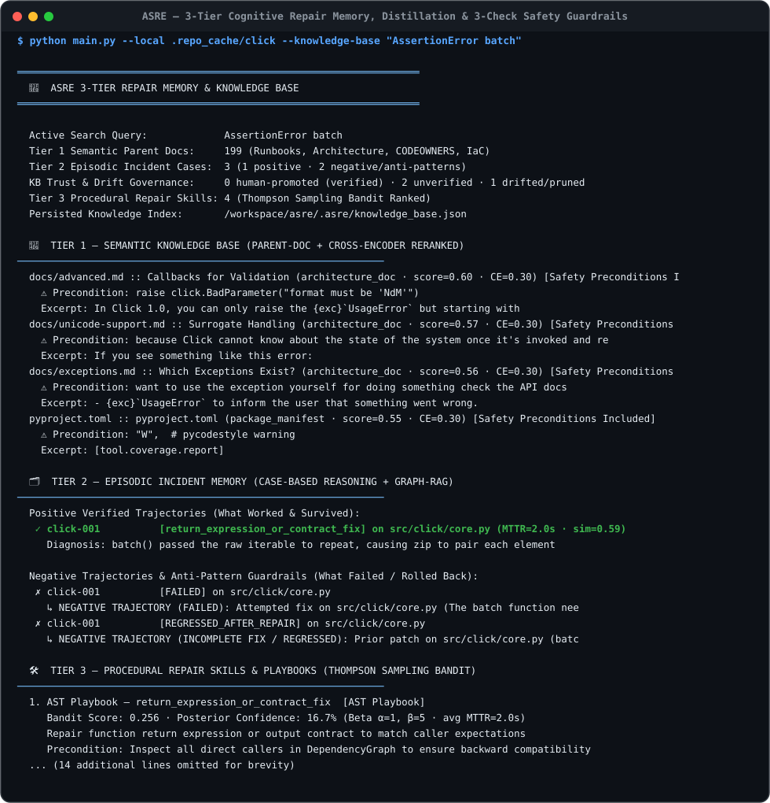
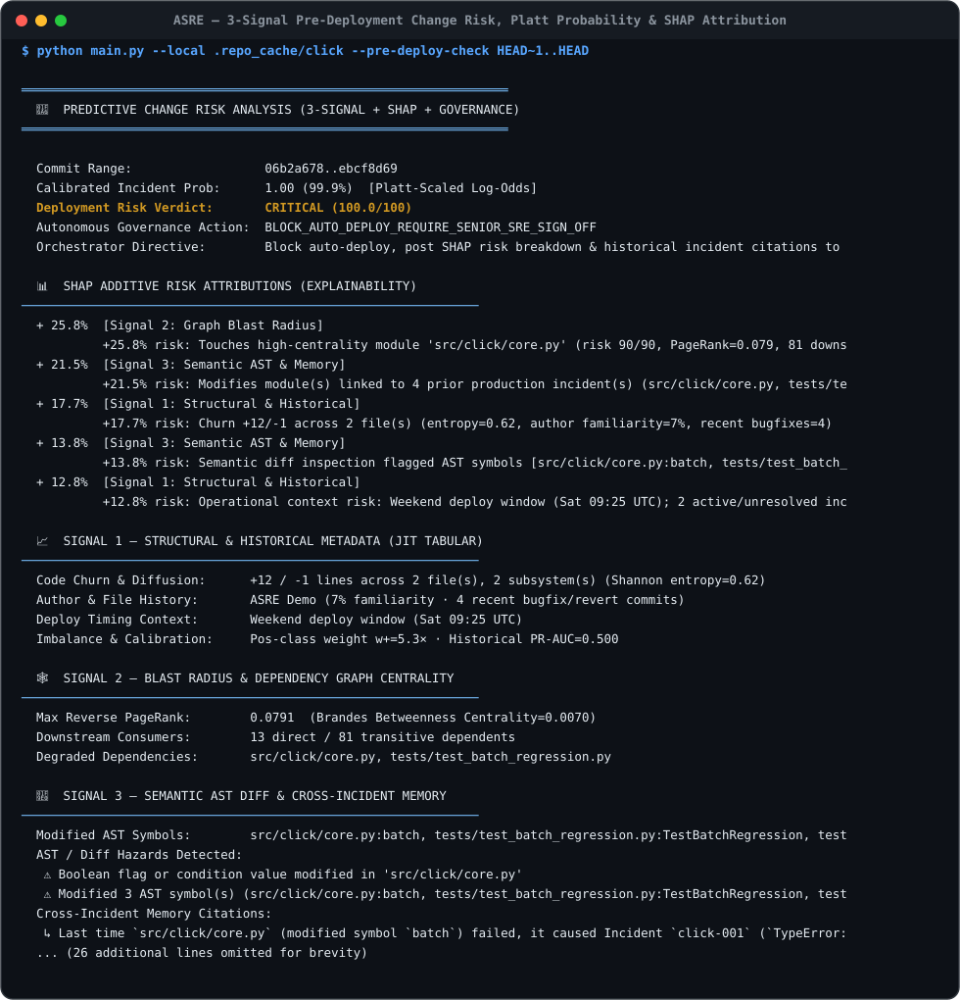
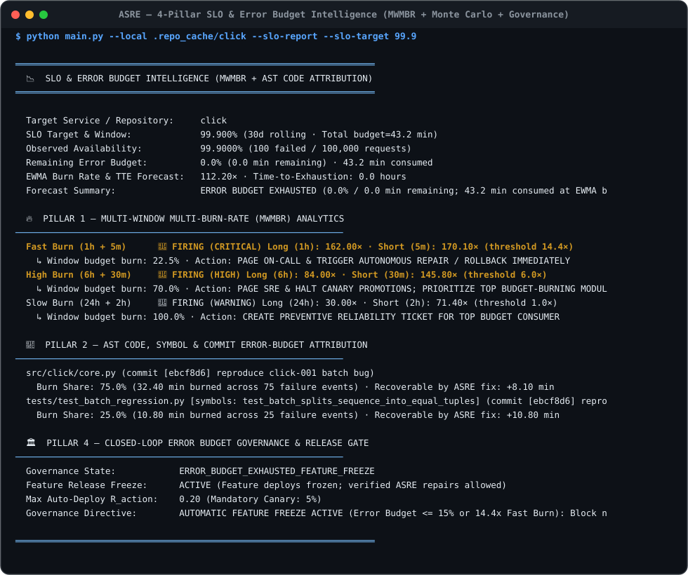
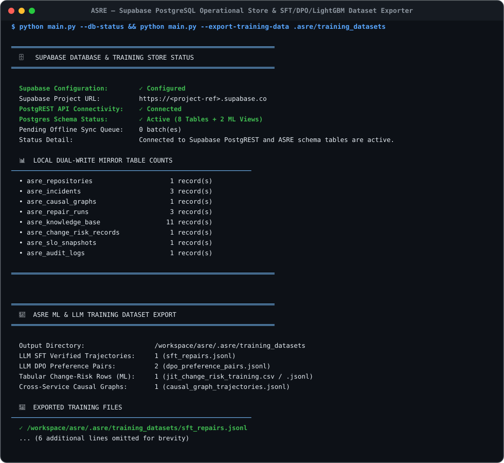

# ASRE — Autonomous Software Reliability Engineer

**ASRE** is a deterministic, graph-grounded Autonomous Software Reliability Engineering platform that connects **multi-language repository intelligence**, **multi-hop cross-service causal discovery**, **4-tier progressive repair simulation & quantitative risk gating ($R_{\text{action}}$)**, **3-tier cognitive repair memory**, **pre-deployment change-risk prediction (Platt + exact SHAP)**, **4-pillar SLO & error budget governance**, and **Supabase PostgreSQL + SFT/DPO/LightGBM training pipelines** into a single auditable closed loop.

---

## System Architecture



---

## Core Capabilities

### 1. Multi-Language Repository & Dependency Graph Intelligence (`intelligence/`)
- **Tree-sitter AST & Manifest Extraction:** Extracts functions, classes, interfaces, structs, call sites, SQL/DB interactions, and ecosystem manifests across Python (`pyproject.toml`, `requirements.txt`), JavaScript/TypeScript (`package.json`, `tsconfig.json`), Go (`go.mod`), Rust (`Cargo.toml`), Java/Kotlin/Scala, Ruby, and PHP (`composer.json` PSR-4).
- **Directed Dependency & Blast-Radius Graph:** Resolves relative, aliased, and package-internal imports into canonical repository paths, computing **Direct Dependents**, **Transitive Dependents**, **Reverse PageRank**, **Brandes Betweenness Centrality**, and deterministic **File Risk Scores (`0–90`)**.

---

### 2. Cross-Incident Intelligence & 4-Stage Multi-Hop Causal Discovery (`repair/cross_incident_intelligence.py`)
Correlates concurrent alerts and multi-service cascades using a 100% domain-neutral algorithm:
- **Drain3 Log Template Mining & 128-D Subword Embeddings:** Splits `camelCase`, `PascalCase`, `snake_case`, and `kebab-case` identifiers into subword tokens and projects them onto a signed 128-dimensional unit hypersphere alongside repository AST vocabulary.
- **4-Stage Multi-Hop Causal Discovery:**
  1. *Explicit Topology:* OpenTelemetry `parent_span_id == span_id` trace links, AST call-graph edges, and HTTP/RPC endpoint producer-consumer matching.
  2. *Temporal Lead-Lag & Granger Precedence:* Exponentially decayed temporal precedence ($\Delta t \ge 0$).
  3. *PC-Style Conditional Independence Pruning:* Transitive reduction removes indirect A $\to$ C correlation edges when an intermediate causal path A $\to$ B $\to$ C explains the cascade.
  4. *Counterfactual Root-Cause Attribution (Do-Calculus):* Evaluates structural causal intervention $\text{do}(\text{Service}_i = \text{Healthy})$ across the inferred DAG to rank each service by the fraction of downstream failures eliminated.



---

### 3. 4-Tier Progressive Repair Simulation & Quantitative Risk Assessment (`repair/repair_simulator.py`)
Every candidate patch is evaluated in an isolated Git worktree through a **4-Tier Progressive Verification Pipeline** before touching the live working tree:

| Verification Tier | Engine & Algorithm | What It Verifies |
| :--- | :--- | :--- |
| **Tier 1: Deterministic Policy & Guardrail Verification** *(ms)* | Formal Policy Invariant Solver (OPA/Rego & SMT style) | Emergency kill switch, strict scope containment (`files_to_modify`), protected auth/DB DDL guards, zero hardcoded secrets, and SLO error-budget freeze compliance. |
| **Tier 2: Graph Blast-Radius & Capacity Simulation** *(sub-sec)* | Queuing Theory ($M/M/c$ Erlang-C $\rho = \lambda / (c\mu)$), SIR Epidemic Cascade ($R_0$), & DoWhy-style Structural Causal Counterfactuals | Predicts post-patch traffic utilization $\rho$, cascade containment probability, counterfactual p99 latency drop (`%`), and DB connection delta (`%`). |
| **Tier 3: Dry-Run & State-Diff Inspection** *(1–2s)* | `git apply --check` + Tree-sitter AST Symbol/Signature Diff | Verifies clean hunk application against live HEAD, syntax validity, public API signature stability, and blast-radius diff bounds. |
| **Tier 4: Shadow / Canary Digital Twin Simulation** *(2–15s)* | Isolated Git Worktree Digital Twin + Pre/Post Incident Replay + Adjacent Consumer Suite | Confirms pre-patch failure reproduction, post-patch incident fix, zero adjacent consumer regressions, and real test execution (`> 0` tests run). |

#### Quantitative Action Risk Formula ($R_{\text{action}} \in [0, 1]$)
$$R_{\text{action}} = 0.35(1 - P_{\text{success}}) + 0.25(\text{BlastRadius}) + 0.20(1 - \text{Reversibility}) + 0.20(\text{Statefulness})$$

- **$R_{\text{action}} < 0.25$ & 4-Tier Simulation Passes:** **Fully Autonomous Execution** (applies fix in a transactional checkout with a post-remediation RED metric rollback watchdog).
- **$0.25 \le R_{\text{action}} \le 0.65$:** **Progressive Canary Execution** (stages rollout to 1 pod / 5% traffic shadow mirror first).
- **$R_{\text{action}} > 0.65$ or Policy Warning:** **Human-in-the-Loop Approval** (generates an interactive approval card with dry-run diff, counterfactual impact, and 1-click `[Approve & Execute]` / `[Reject]` actions).



---

### 4. 3-Tier Cognitive Repair Memory & Closed-Loop Distillation (`repair/knowledge_base.py`)
Prevents knowledge decay and repeated failed hypotheses across incidents:
- **Tier 1 — Semantic Knowledge Base:** Ingests runbooks, architecture docs, `CODEOWNERS`, and IaC manifests using **Parent-Document Hierarchical Chunking** (child chunks indexed via Hybrid BM25 + 128-D Dense RRF and Cross-Encoder reranking, returning full parent sections so safety preconditions are never separated from execution commands).
- **Tier 2 — Episodic Incident Memory:** Stores 4-stage Case-Based Reasoning trajectories tracking both **Positive Playbooks** (verified fixes with 0 post-repair recurrences) and **Negative Guardrails** (failed tests, rejected plans, rollbacks, and fixes that later regressed).
- **Tier 3 — Procedural Repair Memory:** Ranks parameterized AST repair operators using a **Beta-Bernoulli Multi-Armed Bandit (Thompson Sampling)** weighted by Bayesian posterior confidence $\frac{\alpha}{\alpha + \beta}$ and MTTR speed.
- **Closed-Loop Knowledge Distillation & Trust Gate:**
  1. *Trajectory Capture* logs diagnostic queries, executed test commands, and recovery timestamps in `run.json`.
  2. *Post-Incident Reflection Distiller* produces structured JSON + Markdown postmortems (`Root Cause Signature`, `Winning Fix`, `Dead-End Actions to Avoid`, `Preconditions & Blast Radius`).
  3. *Human-in-the-Loop Promotion (`--promote-kb`)* promotes repairs from `kb_trust_status: unverified` $\to$ `verified`.
  4. *Decay & Drift Pruning* automatically flags stored repairs as `archived_drifted` if target files or hunk anchors diverge in subsequent commits.



---

### 5. 3-Signal Pre-Deployment Change Risk Analysis (`intelligence/reliability_intelligence.py`)
Predicts deployment defect probability before code merges or ships (`--pre-deploy-check <rev_range>`):
1. **Signal 1 — Tabular JIT Kamei Software Metrics:** Diffusion (`files_touched`, `subsystems_touched`, normalized Shannon `change_entropy`), Size (`lines_added`, `lines_deleted`), History (`recent_bugfix_commits`), Author Ownership (`author_familiarity_pct`), and Deployment Timing (`is_off_hours_or_friday_deploy`).
2. **Signal 2 — Dependency Graph Blast-Radius Metrics:** Reverse PageRank centrality, Brandes Betweenness Centrality, and direct/transitive downstream consumers.
3. **Signal 3 — Semantic & Config Diff Inspection:** AST-extracted modified functions/classes, config/manifest keys (`pyproject.toml`, `.env`, `Dockerfile`, YAML/JSON), and risky patterns (`DROP/ALTER`, auth bypasses, timeout removals, bare exception suppression).
- Combines all three signals via **Platt-Scaled Logistic Calibration** ($P(\text{incident}) \in [0.00, 1.00]$) with **Exact Additive Log-Odds SHAP Feature Attributions** and an **Autonomous Deployment Governance Gate** (`AUTO_APPROVE_DEPLOY`, `STAGE_CANARY_5PCT`, `BLOCK_AND_REQUIRE_SENIOR_SRE_REVIEW`).



---

### 6. 4-Pillar SLO & Error Budget Intelligence (`intelligence/slo_intelligence.py`)
1. **Multi-Window, Multi-Burn-Rate (MWMBR) Alerting (Google SRE Standard):** Simultaneously evaluates Short/Long dual windows (`5m/1h` Fast Burn $14.4\times$, `30m/6h` High Burn $6.0\times$, `6h/72h` Slow Burn $1.0\times$) so alerts only fire while budget is actively burning and reset rapidly once fixed.
2. **Probabilistic Burn-Rate Forecasting:** Combines EWMA burn-rate smoothing with a **250-path Monte Carlo Exhaustion Simulator** to estimate Time-to-Exhaustion (hours) and 24h/7d exhaustion probabilities.
3. **Structural Code-to-SLO Attribution:** Maps consumed error budget minutes directly to repository source files, recent commits, and downstream dependency blast radius.
4. **Autonomous Error-Budget Governance Gate:** Automatically tightens pre-deployment change-risk thresholds and enforces feature-deployment freezes (allowing only P0 reliability/security fixes) when remaining error budget drops below policy thresholds or a $14.4\times$ fast-burn alert is active.



---

### 7. Supabase PostgreSQL Operational Store & ML/LLM Training Pipeline (`storage/`)
All operational telemetry, causal graphs, repair runs, knowledge base entries, pre-deployment risk records, SLO snapshots, and hash-chained audit logs are dual-written to **Supabase PostgreSQL** (`storage/supabase_schema.sql`) and a zero-latency local JSONL mirror (`.asre/supabase_mirror/*.jsonl`) with offline retry queueing:
- **8 Operational & Training Tables:** `asre_repositories`, `asre_incidents`, `asre_causal_graphs`, `asre_repair_runs`, `asre_knowledge_base`, `asre_change_risk_records`, `asre_slo_snapshots`, `asre_audit_logs`.
- **2 Built-In ML Training Views & Dataset Exporter (`--export-training-data`):**
  - `sft_repairs.jsonl` — Verified positive repair trajectories formatted as chat messages for LLM Supervised Fine-Tuning (SFT).
  - `dpo_preference_pairs.jsonl` (`v_llm_dpo_preference_pairs`) — Paired `(prompt, chosen_verified_diff, rejected_failed_diff)` trajectories on matching `(repo_id, exception_type)` for Direct Preference Optimization (DPO).
  - `jit_change_risk_training.csv` & `.jsonl` (`v_tabular_change_risk_dataset`) — 10-feature tabular + graph + semantic matrices with post-deployment outcome labels for LightGBM/XGBoost calibration.
  - `causal_graph_trajectories.jsonl` — Multi-hop causal chains and do-calculus attribution weights.



---

## Project Layout

```text
asre/
├── main.py                                  # CLI entrypoint & end-to-end workflow orchestrator
├── requirements.txt                         # Python dependencies
├── intelligence/                            # Repository, Graph, Change-Risk & SLO Intelligence
│   ├── scanner.py                           # Ecosystem manifest & repository file scanner
│   ├── analyzer.py                          # Tree-sitter AST symbol, import & call-graph extractor
│   ├── resolver.py                          # Cross-language import-to-filepath resolver
│   ├── dependency_graph.py                  # Directed dependency & transitive impact graph
│   ├── git_analyzer.py                      # 90-day git churn, commit history & diff analyzer
│   ├── risk_scorer.py                       # Deterministic file risk calculator (0-90)
│   ├── file_profile.py                      # Per-file intelligence profile builder
│   ├── query_engine.py                      # Hybrid keyword & BM25 codebase query engine
│   ├── reliability_intelligence.py          # 3-Signal Pre-Deployment Change Risk (Platt + SHAP)
│   ├── slo_intelligence.py                  # 4-Pillar SLO & Error Budget Intelligence engine
│   └── investor_verification.py             # 10-Point Production Readiness verification suite
├── repair/                                  # Incident Correlation, Simulation, Memory & Execution
│   ├── incident_intelligence.py             # Single-stream telemetry deduplication & alert correlation
│   ├── cross_incident_intelligence.py       # 4-Stage Multi-Hop Causal Discovery & Do-Calculus Attribution
│   ├── incident_mapper.py                   # Multi-language traceback parser & RepairContext builder
│   ├── patch_planner.py                     # PatchPlan contract & deterministic diff/command validator
│   ├── llm_advisor.py                       # Multi-provider LLM Patch Planner & Self-Correction Loop
│   ├── repair_simulator.py                  # 4-Tier Progressive Verification & R_action Risk Engine
│   ├── patch_executor.py                    # Isolated Git worktree verifier, PR creator & auto-rollback
│   ├── knowledge_base.py                    # 3-Tier Cognitive Repair Memory & Closed-Loop Distillation
│   ├── production_guard.py                  # Secret redaction, RBAC policy, kill switch & audit log
│   └── repair_runs.py                       # Persistent .asre/runs/ artifact & lesson store
├── storage/                                 # Cloud Persistence & ML/LLM Dataset Generation
│   ├── supabase_schema.sql                  # PostgreSQL DDL (8 tables, RLS policies, 2 ML views)
│   └── supabase_store.py                    # Dual-write PostgREST client, mirror & dataset exporter
├── reporting/                               # Terminal & JSON report renderers
├── examples/click-001/                      # Sample single-incident & multi-incident payloads
└── tests/                                   # Comprehensive unit & end-to-end integration test suite
```

---

## Installation & Configuration

Requires **Python 3.11+** and **Git**.

```bash
python3 -m venv venv
./venv/bin/pip install -r requirements.txt
```

### Environment Variables (`.env`)
Create a `.env` file in the project root (all secrets are automatically redacted from logs, artifacts, and database payloads by `production_guard.py`):

```ini
# Optional: LLM Provider API Keys for Autonomous Patch Generation (auto-detects available key)
GEMINI_API_KEY=your_gemini_api_key
OPENAI_API_KEY=your_openai_api_key
ANTHROPIC_API_KEY=your_anthropic_api_key

# Optional: Supabase PostgreSQL & PostgREST Persistence
SUPABASE_URL=https://<your-project-ref>.supabase.co
SUPABASE_KEY=sb_publishable_<your-api-key>
SUPABASE_DB_URL=postgresql://postgres.<your-project-ref>:<your-db-password>@aws-1-eu-west-1.pooler.supabase.com:5432/postgres
```

---

## CLI Quick Reference

### 1. Repository & Dependency Graph Intelligence
```bash
# Scan a remote GitHub repository or local checkout
./venv/bin/python main.py pallets/click
./venv/bin/python main.py --local .repo_cache/click --graph --list-critical

# Inspect blast radius ("what breaks if this file changes?") and file intelligence profile
./venv/bin/python main.py --local .repo_cache/click --impact src/click/core.py
./venv/bin/python main.py --local .repo_cache/click --profile src/click/core.py
```

### 2. Multi-Hop Cross-Incident Causal Discovery
```bash
# Correlate multi-service incidents, build causal DAG, and compute counterfactual attribution
./venv/bin/python main.py --local .repo_cache/click \
  --cross-incident examples/click-001/cross-incidents.json
```

### 3. Incident Diagnosis, 4-Tier Simulation & Verified Patch Execution
```bash
# Validate and verify a patch plan in an isolated Git worktree with 4-tier simulation
./venv/bin/python main.py --local .repo_cache/click \
  --incident examples/click-001/incident.json \
  --patch-plan examples/click-001/patch-plan.json \
  --verify-patch-plan \
  --repair-run-dir .asre/runs

# Generate, self-correct, and verify a patch plan using an LLM provider
./venv/bin/python main.py --local .repo_cache/click \
  --incident examples/click-001/incident.json \
  --generate-patch-plan \
  --verify-patch-plan \
  --repair-run-dir .asre/runs
```

### 4. 3-Tier Cognitive Repair Memory & Trust Promotion
```bash
# Query Tier 1 Runbooks, Tier 2 Episodic Cases, Tier 3 Bandit Skills & Safety Guardrails
./venv/bin/python main.py --local .repo_cache/click \
  --knowledge-base "AssertionError batch"

# Promote an unverified postmortem repair record to verified for autonomous execution
./venv/bin/python main.py --local .repo_cache/click \
  --promote-kb click-001 \
  --approver senior-sre@example.com
```

### 5. Pre-Deployment Change Risk & SLO Error Budget Governance
```bash
# Run 3-Signal Pre-Deployment Change Risk Analysis (Tabular + Graph + Semantic + SHAP)
./venv/bin/python main.py --local .repo_cache/click \
  --pre-deploy-check HEAD~1..HEAD

# Run 4-Pillar SLO & Error Budget Intelligence (MWMBR + Monte Carlo + Release Freeze Gate)
./venv/bin/python main.py --local .repo_cache/click \
  --slo-report --slo-target 99.9

# Run the 10-Point Production Readiness & Autonomous Safety Verification Suite
./venv/bin/python main.py --local .repo_cache/click --investor-report
```

### 6. Supabase Database Sync & ML/LLM Training Dataset Export
```bash
# Apply PostgreSQL schema migration (8 tables + 2 ML views) and check status
./venv/bin/python main.py --init-db --db-status

# Backfill local runs, knowledge base & audit logs to Supabase and export SFT/DPO/ML datasets
./venv/bin/python main.py --local .repo_cache/click \
  --sync-db \
  --export-training-data .asre/training_datasets
```

---

## Running the Test Suite

Execute the full unit and end-to-end integration test suite:

```bash
./venv/bin/python -m unittest discover -s tests -v
```
